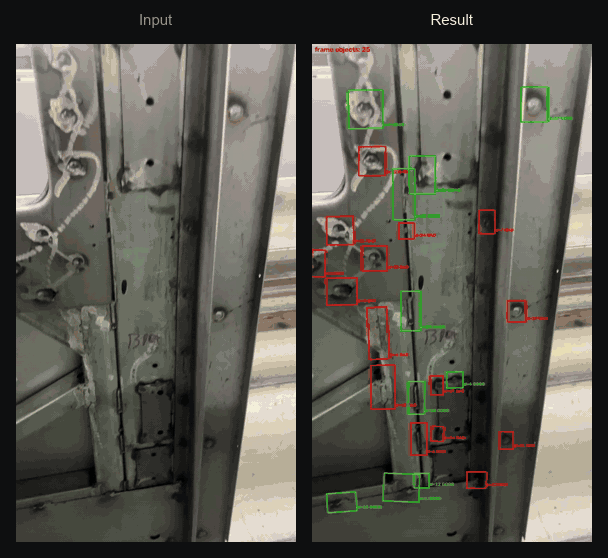
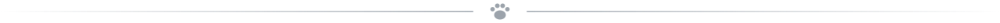
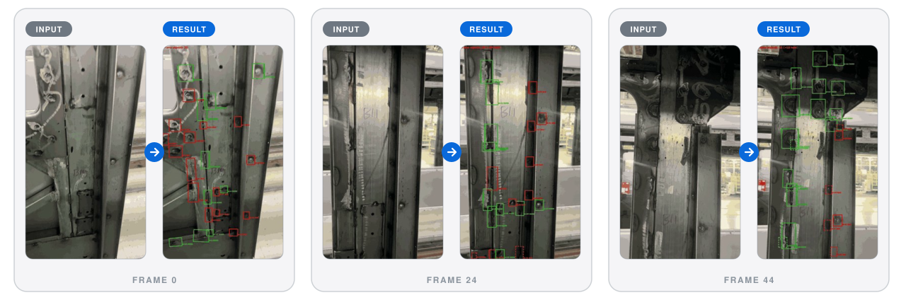

<div align="center">

<picture>
  <source media="(prefers-color-scheme: dark)" srcset="docs/assets/banner/banner-ko-dark.svg">
  
</picture>

**사진·영상을 넣으면 → 회전 박스, GOOD / BAD 판정, 그리고 불확실성 표시까지 돌려줍니다.**<br>
순수 PyTorch · CPU / GPU · CLI, Python API, 웹 UI 제공

<p>
  
  <a href="https://github.com/hyundaimotorgroup/hmg-physical-quality-decision-ai/actions/workflows/ci.yml"></a>
  
  
  
</p>

<p>
  <a href="#결과-미리보기"><b>데모</b></a> &nbsp;·&nbsp;
  <a href="#5분-시작하기"><b>빠른 시작</b></a> &nbsp;·&nbsp;
  <a href="#동작-방식"><b>동작 방식</b></a> &nbsp;·&nbsp;
  <a href="#결과"><b>성능</b></a> &nbsp;·&nbsp;
  <a href="#문서"><b>문서</b></a> &nbsp;·&nbsp;
  <a href="README.md"><b>English</b></a>
</p>



</div>

> **v0.1 프리뷰.** 분류기는 성숙한 상태이지만 **탐지기는 아직 개선 중입니다** ([알려진 한계](#알려진-한계) 참고). **의사결정 보조 도구이며, 인증된 검사 시스템이나 안전 인증 시스템이 아닙니다.** 반드시 자체 데이터로 검증하고, 사람 검토자를 함께 두세요.

---

<p align="center"></p>

## 결과 미리보기

친구들이 보는 화면은 이렇습니다. 위 데모 영상에서 뽑은 세 프레임입니다. **빨강 = BAD, 초록 = GOOD.** 왼쪽은 카메라 프레임, 오른쪽은 그에 대한 파이프라인 출력입니다.

<p align="center">
  
</p>

대상마다 자기 회전 박스와 판정을 받습니다. BAD가 하나라도 있으면 전체 항목이 BAD가 되고, 분류기가 확신하지 못한 크롭은 레퍼런스 뱅크와 대조합니다. 놓치거나 박스가 느슨한 경우도 있으니 [알려진 한계](#알려진-한계)를 함께 확인하세요.

<p align="center"></p>

## 왜 이 프로젝트인가

<table>
<tr>
<td width="50%" valign="top">

**🎯 회전 박스 탐지**<br>
타일링한 이미지에서 각 대상을 회전 박스로 찾아, 작고 길쭉한 대상도 놓치지 않습니다.

</td>
<td width="50%" valign="top">

**🧭 정직한 판정**<br>
분류기가 불확실할 때(엔트로피가 `alpha` 초과) 큐레이션된 레퍼런스 뱅크와 비교해 상위 k개 이웃이 다수결로 판정합니다.

</td>
</tr>
<tr>
<td valign="top">

**🛡️ 안전 우선 집계**<br>
대상 하나라도 BAD이면 전체 항목을 BAD로 판정합니다. 놓치지 않는 쪽을 우선합니다.

</td>
<td valign="top">

**🎞️ 사진과 영상**<br>
밝기 TTA와 프레임 간 추적을 내장했습니다.

</td>
</tr>
<tr>
<td valign="top">

**🧩 도메인 독립 코어**<br>
특정 대상에 묶이지 않는 부분은 모두 공통입니다. **용접(weld)이 첫 번째 도메인**이며, 새 도메인은 `DomainSpec` 플러그인으로 추가합니다 ([가이드](docs/DOMAIN_PLUGINS.md)).

</td>
<td valign="top">

**📦 바로 사용 가능**<br>
CLI, Python API, 리포트가 포함된 웹 UI, 그리고 sha256으로 검증되는 매니페스트가 달린 가중치를 제공합니다.

</td>
</tr>
</table>

<p align="center"></p>

## 동작 방식

<p align="center">
<picture>
  <source media="(prefers-color-scheme: dark)" srcset="docs/assets/design/pipeline-ko-dark.svg">
  
</picture>
</p>

<details>
<summary><b>단계별 설명</b></summary>

| 단계 | 하는 일 |
|---|---|
| **1. 탐지** | 타일링 회전 박스 탐지기가 후보를 찾고, 타일 간 중복을 합친 뒤 각 후보를 여백을 둔 원해상도 크롭에서 다시 확인합니다. |
| **2. 크롭** | 각 박스를 원근 보정해 반듯한 직사각형으로 펼칩니다. |
| **3. 분류** | 밝기를 달리한 5개 뷰의 평균으로 GOOD / BAD 확률과 엔트로피를 계산합니다. |
| **4. 게이트** | 엔트로피가 낮으면 분류기가 결정합니다. 높으면 크롭 임베딩을 레퍼런스 뱅크와 비교해 이웃들이 투표합니다(`used_retrieval=True`). |
| **5. 집계** | 대상 하나라도 BAD이면 항목이 BAD입니다. 영상에서는 BAD 프레임이 하나라도 있으면 추적된 대상이 BAD가 됩니다. 동률이면 BAD를 따릅니다. |

</details>

자세한 내용은 [docs/architecture.md](docs/architecture.md)를 참고하세요.

<p align="center"></p>

## 5분 시작하기

```bash
git clone https://github.com/hyundaimotorgroup/hmg-physical-quality-decision-ai.git
cd hmg-physical-quality-decision-ai
pip install -e ".[web]"              # Python 3.10 이상, CPU 또는 GPU torch
pqdai verify-weights --domain weld   # 번들 가중치 sha256 검증
```

> 가중치는 `weights/weld/`에 있습니다. `verify-weights`가 git-lfs 포인터 파일 같다고 알려주면 `git lfs install && git lfs pull`을 실행하세요.

<details open>
<summary><b>명령줄 (CLI)</b></summary>

```bash
pqdai domains                                             # weld, example_template
pqdai bank eval --domain weld                             # 번들 레퍼런스 뱅크의 leave-one-out 정확도 (~0.994)
pqdai image --image photo.jpg --out out.jpg --json out.json
pqdai video --video clip.mp4 --out runs/clip --max-seconds 30
```

탐지 결과가 없는 사진은 `overall: GOOD (0 object(s))`로 출력됩니다. 이는 "아무것도 찾지 못했다"는 뜻이지 품질이 확인되었다는 뜻이 아니므로 객체 수를 함께 확인하세요.

</details>

<details>
<summary><b>Python API</b></summary>

```python
from pqdai.core.runtime import build_pipeline

verdict = build_pipeline("weld").judge_image("photo.jpg")
print(verdict.overall_class_name,
      [(o.class_name, o.detection_confidence) for o in verdict.objects])
```

</details>

<details>
<summary><b>웹 UI</b></summary>

```bash
pqdai serve --domain weld            # http://127.0.0.1:8000
```

이미지나 영상을 올리고 진행 상황, 결과 오버레이, 리포트를 확인할 수 있습니다. 로그인은 **비밀번호 없는 이름 선택 방식**이므로 신뢰할 수 있는 네트워크나 인증 리버스 프록시 뒤에서만 실행하세요. [docs/WEBAPP.md](docs/WEBAPP.md)와 [SECURITY.md](.github/SECURITY.md)를 참고하세요.

</details>

<details>
<summary><b>현장에 맞게 레퍼런스 뱅크 만들기</b></summary>

```bash
pqdai bank build --crops my_crops/ --out my_bank.npz     # 클래스 이름별 하위 폴더
pqdai bank info  --bank my_bank.npz
pqdai bank merge a.npz b.npz --out merged.npz
```

자세한 내용: [docs/REFERENCE_BANK.md](docs/REFERENCE_BANK.md).

</details>

## 결과

<p align="center">
<picture>
  <source media="(prefers-color-scheme: dark)" srcset="docs/assets/design/results-ko-dark.svg">
  
</picture>
</p>

<details>
<summary><b>같은 수치를 표로 보기</b></summary>

| 지표 (v0.1.0 가중치, 홀드아웃 검증 데이터) | 값 |
|---|:---:|
| 분류기: 원래 라벨 대비 정확도 | **93.3 %** |
| 분류기: 파이프라인 단위 일치율 (TTA + 뱅크 게이트) | **96.6 %** |
| 탐지기: recall @ IoU 0.5 (사진 99장, 전체 타일링 파이프라인) | **79.6 %** |
| 탐지기: recall @ IoU 0.7 | **46.1 %** |
| 레퍼런스 뱅크: leave-one-out 정확도 (`pqdai bank eval`) | **~0.994** |

</details>

평가 조건, 탐지기 precision, 각 수치의 주의점은 [모델 카드](docs/MODEL_CARD.md)에 있습니다. 이 수치는 참고용이며 성능 보장이 아닙니다.

<p align="center"></p>

## 알려진 한계

> 🐾 *무리의 한마디: "확신이 없으면 없다고 말할게요. 마지막 판단은 사람 몫이에요."*

* **탐지기 박스는 IoU가 높아질수록 느슨해집니다.** recall이 IoU 0.5에서 79.6 %이지만 IoU 0.7에서는 46.1 %로 떨어지고 신뢰도 점수도 낮은 편이라, 고정 임계값(`--conf`, `--verify-conf`)을 자체 데이터에 맞게 다시 조정해야 할 수 있습니다.
* **BAD를 과소 판정합니다.** BAD 샘플이 21개뿐인 작은 검증 부분집합에서 recall이 약 60 %이며 추정치가 불안정합니다. GOOD 판정을 품질의 증거로 취급하지 마세요.
* **현장에 맞게 레퍼런스 뱅크를 다시 만들고**, 애매한 경우는 사람이 검토하세요. 엔트로피 게이트가 불확실한 크롭을 표시합니다(`used_retrieval=True`).
* **데이터 한계:** 제한된 작업물과 조명에서 촬영한 휴대폰 사진·영상입니다. 다른 환경에서는 성능이 떨어질 수 있습니다.
* **용도:** 의사결정 보조 전용입니다. 인증 시스템이 아니며 안전 인증을 받지 않았습니다. 의존하기 전에 반드시 자체 데이터로 검증해야 합니다.

## 저장소 구조

```text
src/pqdai/      core/ models/ video/ domains/ cli.py     라이브러리
webapp/         FastAPI 백엔드 + 정적 프런트엔드            웹 UI
weights/<dom>/  safetensors + JSON 매니페스트              배포 모델
docs/           아키텍처, 플러그인, 뱅크, 영상, 웹앱, 모델 카드, 라이선스
tests/          CPU 전용 테스트
```

## 문서

| | |
|---|---|
| [사용자 가이드](docs/user_guide.html) (영문) | 웹앱 전체 사용 흐름 |
| [아키텍처](docs/architecture.md) | 코어 하네스와 도메인 플러그인 |
| [모델 카드](docs/MODEL_CARD.md) | 모델, 출처, 용도, 지표 |
| [도메인 플러그인](docs/DOMAIN_PLUGINS.md) | `DomainSpec`으로 새 대상 추가 |
| [레퍼런스 뱅크](docs/REFERENCE_BANK.md) · [영상](docs/VIDEO.md) · [웹앱](docs/WEBAPP.md) | 기능별 가이드 |
| [탐지기 비교](docs/DETECTOR_COMPARISON.md) | 탐지기 관련 메모 |
| [기여 가이드](.github/CONTRIBUTING.md) · [보안](.github/SECURITY.md) · [변경 이력](CHANGELOG.md) | 프로젝트 정책 |

기여 환경: `pip install -e ".[dev,web]"` 후 `ruff check src tests webapp`, `pytest` (CPU 전용).

## 기여 안내

프로젝트에 대한 기여를 환영합니다.

기여하기 전에 다음 문서를 확인해 주세요.

- [기여 가이드](.github/CONTRIBUTING.md)
- [기여자 라이선스 동의서 (국문)](https://github.com/hyundaimotorgroup/.github/blob/main/legal/CLA-KOR.md)
- [기여자 라이선스 동의서 (영문)](https://github.com/hyundaimotorgroup/.github/blob/main/legal/CLA-ENG.md)

CLA 검증이 활성화된 경우, Pull Request가 병합되기 전에 기여자 라이선스 동의서(CLA) 절차를 완료해야 할 수 있습니다.


## 프로젝트 정책

- [행동 강령](.github/CODE_OF_CONDUCT.md)
- [보안 정책](.github/SECURITY.md)


## 지원

중복 이슈 등록을 방지하기 위해 새로운 이슈를 등록하기 전에 기존 이슈를 먼저 확인해 주세요.

버그 제보, 기능 요청 및 프로젝트 관련 일반적인 논의는 다음 채널을 이용해 주세요.

- [GitHub Issues](https://github.com/hyundaimotorgroup/hmg-physical-quality-decision-ai/issues)
- [Issue Templates](.github/ISSUE_TEMPLATE/)

보안 관련 문의 및 제보는 다음 안내를 따라 주세요.

- [보안 정책](.github/SECURITY.md)의 안내를 따라 주세요.


## 릴리스

릴리스 노트 및 버전 변경 이력은 다음에서 확인할 수 있습니다.

- [변경 이력](./CHANGELOG.md)
- [릴리스 노트](https://github.com/hyundaimotorgroup/hmg-physical-quality-decision-ai/releases)

본 프로젝트는 [Semantic Versioning](https://semver.org/)을 따릅니다.

## 라이선스

코드와 가중치는 Apache-2.0입니다 ([LICENSE](LICENSE), [docs/LICENSING.md](docs/LICENSING.md)). 추론 코드와 가중치만 공개하며 모델 학습 코드는 포함하지 않습니다. 서드파티 의존성 라이선스는 [THIRD_PARTY_LICENSES](THIRD_PARTY_LICENSES)에 정리되어 있습니다.

<div align="center">
<sub>정성과 호기심, 그리고 적당한 의심으로 만들었습니다. 🐾</sub>
</div>
