<div align="center">

<picture>
  <source media="(prefers-color-scheme: dark)" srcset="docs/assets/banner/banner-en-dark.svg">
  
</picture>

**Photo or video in → oriented boxes, GOOD / BAD verdicts and an honest uncertainty flag out.**<br>
Plain PyTorch · CPU or GPU · CLI, Python API and web UI.

<p>
  
  <a href="https://github.com/hyundaimotorgroup/hmg-physical-quality-decision-ai/actions/workflows/ci.yml"></a>
  
  
  
</p>

<p>
  <a href="#see-it-in-action"><b>Demo</b></a> &nbsp;·&nbsp;
  <a href="#quick-start"><b>Quick start</b></a> &nbsp;·&nbsp;
  <a href="#how-it-works"><b>How it works</b></a> &nbsp;·&nbsp;
  <a href="#results"><b>Results</b></a> &nbsp;·&nbsp;
  <a href="#documentation"><b>Docs</b></a> &nbsp;·&nbsp;
  <a href="README.ko.md"><b>한국어</b></a>
</p>


</div>

> **v0.1 preview.** The classifier is in a mature state; the **detector is still being improved** (see [Known limitations](#known-limitations)). This is **decision support, not a certified or safety-certified inspection system**. Validate it on your own data and keep a human reviewer in the loop.

---

## See it in action

Here is what the critters see: three frames taken from the demo clip above. **Red = BAD, green = GOOD.** Left is the camera frame, right is the pipeline's output for it.

<p align="center">
  
</p>

Each object gets its own oriented box and verdict. One BAD object is enough to make the whole item BAD, and a crop the classifier is unsure about is checked against the reference bank. Expect misses and loose boxes too (see [Known limitations](#known-limitations)).

<p align="center"></p>

## Why this project

<table>
<tr>
<td width="50%" valign="top">

**🎯 Oriented boxes**<br>
Objects are detected as rotated boxes on tiled images, so small and elongated targets are not lost.

</td>
<td width="50%" valign="top">

**🧭 Honest decisions**<br>
When the classifier is unsure (entropy above `alpha`), the crop is matched against a curated reference bank and the top-k neighbours vote.

</td>
</tr>
<tr>
<td valign="top">

**🛡️ Safety-first aggregation**<br>
One BAD object makes the whole item BAD. This favours sensitivity over silence.

</td>
<td valign="top">

**🎞️ Photo and video**<br>
Photometric test-time augmentation and cross-frame tracking are built in.

</td>
</tr>
<tr>
<td valign="top">

**🧩 Domain-agnostic core**<br>
Everything not specific to one kind of object is shared. **Weld inspection is the first domain**; a new one plugs in with a small `DomainSpec` ([guide](docs/DOMAIN_PLUGINS.md)).

</td>
<td valign="top">

**📦 Ready to use**<br>
CLI, Python API, a web UI with reports, and released weights with sha256-verified manifests.

</td>
</tr>
</table>

<p align="center"></p>

## How it works

<p align="center">
<picture>
  <source media="(prefers-color-scheme: dark)" srcset="docs/assets/design/pipeline-en-dark.svg">
  
</picture>
</p>

<details>
<summary><b>Stage by stage</b></summary>

| Stage | What happens |
|---|---|
| **1. Detect** | A tiled oriented-box detector finds candidates, merges duplicates across tiles and re-checks each one on a padded full-resolution crop. |
| **2. Crop** | Each box is perspective-warped to an upright rectangle. |
| **3. Classify** | Five photometric views are averaged into GOOD / BAD probabilities plus an entropy score. |
| **4. Gate** | Low entropy: the classifier decides. High entropy: the crop's embedding is compared with the reference bank and the nearest neighbours vote (`used_retrieval=True`). |
| **5. Aggregate** | One BAD object makes the item BAD. In video, one BAD frame makes a tracked object BAD. Ties favour BAD. |

</details>

Full detail: [docs/architecture.md](docs/architecture.md).

<p align="center"></p>

## Quick start

```bash
git clone https://github.com/hyundaimotorgroup/hmg-physical-quality-decision-ai.git
cd hmg-physical-quality-decision-ai
pip install -e ".[web]"              # Python >= 3.10, CPU or GPU torch
pqdai verify-weights --domain weld   # sha256 check of the bundled weights
```

> Weights live in `weights/weld/`. If `verify-weights` says a file looks like a git-lfs pointer, run `git lfs install && git lfs pull`.

<details open>
<summary><b>Command line</b></summary>

```bash
pqdai domains                                             # lists: weld, example_template
pqdai bank eval --domain weld                             # leave-one-out accuracy of the bundled bank (~0.994)
pqdai image --image photo.jpg --out out.jpg --json out.json
pqdai video --video clip.mp4 --out runs/clip --max-seconds 30
```

A photo with no detections prints `overall: GOOD (0 object(s))`. That means *nothing was found*, not that something was verified, so always check the object count.

</details>

<details>
<summary><b>Python API</b></summary>

```python
from pqdai.core.runtime import build_pipeline

verdict = build_pipeline("weld").judge_image("photo.jpg")
print(verdict.overall_class_name,
      [(o.class_name, o.detection_confidence) for o in verdict.objects])
```

</details>

<details>
<summary><b>Web UI</b></summary>

```bash
pqdai serve --domain weld            # http://127.0.0.1:8000
```

Upload images or videos, follow progress, and open the result overlay and report. The login is a name picker **without a password**, so run it on a trusted network or behind an authenticating reverse proxy. See [docs/WEBAPP.md](docs/WEBAPP.md) and [SECURITY.md](.github/SECURITY.md).

</details>

<details>
<summary><b>Tune the reference bank for your site</b></summary>

```bash
pqdai bank build --crops my_crops/ --out my_bank.npz     # one sub-folder per class name
pqdai bank info  --bank my_bank.npz
pqdai bank merge a.npz b.npz --out merged.npz
```

Details: [docs/REFERENCE_BANK.md](docs/REFERENCE_BANK.md).

</details>

<p align="center"></p>

## Results

<p align="center">
<picture>
  <source media="(prefers-color-scheme: dark)" srcset="docs/assets/design/results-en-dark.svg">
  
</picture>
</p>

<details>
<summary><b>Same numbers as a table</b></summary>

| Metric (v0.1.0 weights, held-out validation data) | Value |
|---|:---:|
| Classifier: accuracy vs original labels | **93.3 %** |
| Classifier: pipeline-level agreement (TTA + bank gate) | **96.6 %** |
| Detector: recall @ IoU 0.5 (99 photos, full tiled pipeline) | **79.6 %** |
| Detector: recall @ IoU 0.7 | **46.1 %** |
| Reference bank: leave-one-out accuracy (`pqdai bank eval`) | **~0.994** |

</details>

Evaluation conditions, the detector's precision and the caveats behind each number are in the [model card](docs/MODEL_CARD.md). Treat these figures as indicative, not as guarantees.

<p align="center"></p>

## Known limitations

> 🐾 *From the herd: "If we're not sure, we'll say so, and a human gets the last word."*

* **Detector boxes are loose at tight IoU.** Recall falls from 79.6 % at IoU 0.5 to 46.1 % at IoU 0.7, and confidence scores are on the low side, so fixed thresholds (`--conf`, `--verify-conf`) may need re-tuning on your data.
* **BAD is under-called.** BAD recall is about 60 % on a small validation subset with only 21 BAD samples, so that figure is noisy. A GOOD verdict is not proof of quality.
* **Rebuild the reference bank for your site** and have a person review borderline cases. The entropy gate marks the uncertain crops (`used_retrieval=True`).
* **Limited data:** phone photos and video of a limited set of workpieces and lighting. Expect degradation elsewhere.
* **Intended use:** decision support only. Not certified, not safety-certified. Validate on your own data before relying on it.

## Repository layout

```text
src/pqdai/      core/ models/ video/ domains/ cli.py     library
webapp/         FastAPI backend + static front end        web UI
weights/<dom>/  safetensors + JSON manifests              released models
docs/           architecture, plugins, bank, video, web app, model card, licensing
tests/          CPU-only tests
```

## Documentation

| | |
|---|---|
| [User guide](docs/user_guide.html) | End-to-end walkthrough of the web app |
| [Architecture](docs/architecture.md) | Core harness and domain plugins |
| [Model card](docs/MODEL_CARD.md) | Models, provenance, intended use, metrics |
| [Domain plugins](docs/DOMAIN_PLUGINS.md) | Add a new object type with a `DomainSpec` |
| [Reference bank](docs/REFERENCE_BANK.md) · [Video](docs/VIDEO.md) · [Web app](docs/WEBAPP.md) | Feature guides |
| [Detector comparison](docs/DETECTOR_COMPARISON.md) | Detector notes |
| [Contributing](.github/CONTRIBUTING.md) · [Security](.github/SECURITY.md) · [Changelog](CHANGELOG.md) | Project policies |

Contributing setup: `pip install -e ".[dev,web]"`, then `ruff check src tests webapp` and `pytest` (CPU only).

## Contributing

Contributions are welcome.

Before contributing, please review:

- [Contributing Guide](.github/CONTRIBUTING.md)
- [Contributor License Agreement (Korean)](https://github.com/hyundaimotorgroup/.github/blob/main/legal/CLA-KOR.md)
- [Contributor License Agreement (English)](https://github.com/hyundaimotorgroup/.github/blob/main/legal/CLA-ENG.md)

If CLA verification is enabled, contributors may be required to complete the Contributor License Agreement (CLA) process before their pull request can be merged.

## Project Policies

- [Code of Conduct](.github/CODE_OF_CONDUCT.md)
- [Security Policy](.github/SECURITY.md)

## Support

Before creating a new issue, please search existing issues to avoid duplicates.

For bug reports, feature requests, and general project discussions:

- [GitHub Issues](https://github.com/hyundaimotorgroup/hmg-physical-quality-decision-ai/issues)
- [Issue Templates](.github/ISSUE_TEMPLATE/)

For security concerns:

- Follow the instructions in [Security Policy](.github/SECURITY.md).


## Releases

Release notes and version history are available in the following locations:
- [Changelog](./CHANGELOG.md)
- [Release Notes](https://github.com/hyundaimotorgroup/hmg-physical-quality-decision-ai/releases)

This project follows [Semantic Versioning](https://semver.org/).


## License

Apache-2.0 for code and weights ([LICENSE](LICENSE), [docs/LICENSING.md](docs/LICENSING.md)). Only inference code and weights are published; model training code is not part of this repository. Third-party dependency licenses are listed in [THIRD_PARTY_LICENSES](THIRD_PARTY_LICENSES).

<div align="center">
<sub>Made with care, curiosity and a healthy dose of doubt. 🐾</sub>
</div>
