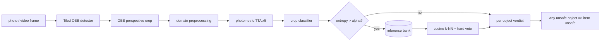

# Architecture

Physical Quality Decision AI (`pqdai`) splits a *shared core harness* from per-*domain* plugins.
`weld` is the first domain; others plug in without touching `pqdai/core`.

## Photo pipeline (`pqdai.core.pipeline.QualityPipeline`)
1. **Detect** (`pqdai.core.tiled_detector.TiledDetector`): single-shot for small images, sliced inference above `tile_threshold` px; cross-tile duplicates merged by Weighted Boxes Fusion on axis-aligned envelopes while keeping the original oriented polygon; IoS containment suppression.
2. **Refine** (coarse-to-fine): every candidate is re-detected on a generously padded full-resolution crop; with `verify_conf` this doubles as verification. IoU NMS (largest box wins) and gap bridging recover split objects.
3. **Crop** (`obb_crop`): perspective-warp the quadrilateral to an upright rectangle (+10 % padding).
4. **Classify**: the domain's preprocessing (weld: LAB adaptive gamma), five photometric TTA views, mean probabilities, entropy.
5. **Selective retrieval**: if entropy > `alpha`, cosine k-NN over the reference bank and a hard vote; ties favour the unsafe class (index 0). See [REFERENCE_BANK.md](REFERENCE_BANK.md).
6. **Item verdict**: any object of the unsafe class makes the item unsafe.

## Video pipeline (`pqdai.video`) - see [VIDEO.md](VIDEO.md)
Sampling, camera ego-motion, Kalman tracking with distractor-aware matching, bead clustering, sticky-unsafe aggregation, overlay video, HTML report and a duplicate-count audit.

## Models (`pqdai.models`)
Original plain-PyTorch implementations: `CropClassifierNet` (residual CNN with squeeze-excite; 1280-d embedding head) and `OBBDetectorNet` (CSP backbone, PAN neck, dual one-to-many / one-to-one anchor-free oriented-box head). Weights are `safetensors` + JSON manifests, verified by sha256 ([MODEL_CARD.md](MODEL_CARD.md)).

## Packages
| package | role |
|---|---|
| `pqdai.core` | pipeline, tiled detector, OBB crop, preprocessing, retrieval/voting/uncertainty, reference bank, weights manifests, runtime builder |
| `pqdai.models` | network definitions, inference wrappers |
| `pqdai.video` | tracking and video reports |
| `pqdai.domains` | `DomainSpec` registry, `weld`, `example_template` |
| `pqdai.cli` | `pqdai image / video / serve / bank / domains / verify-weights` |
| `webapp/` | FastAPI backend + static frontend ([WEBAPP.md](WEBAPP.md)) |
